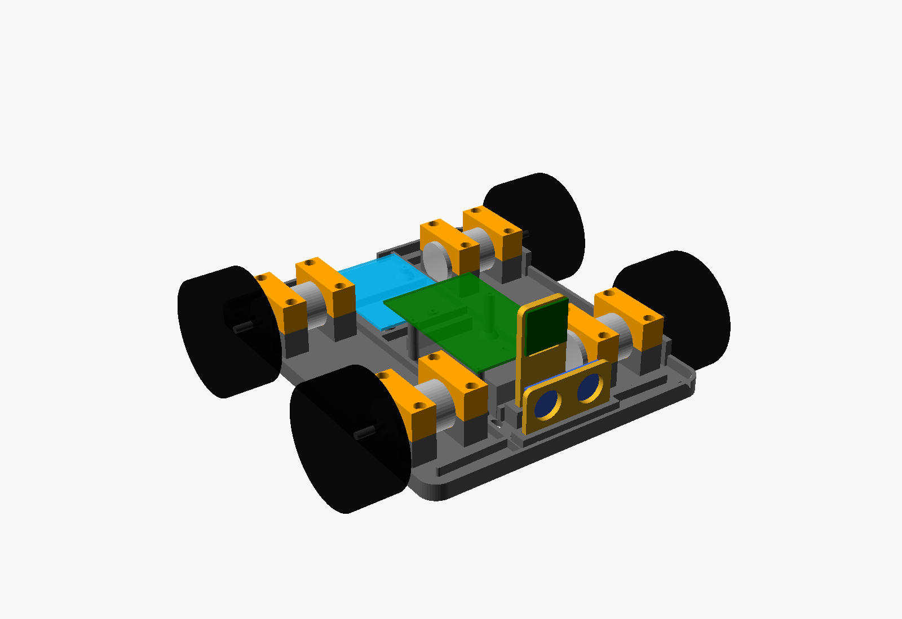
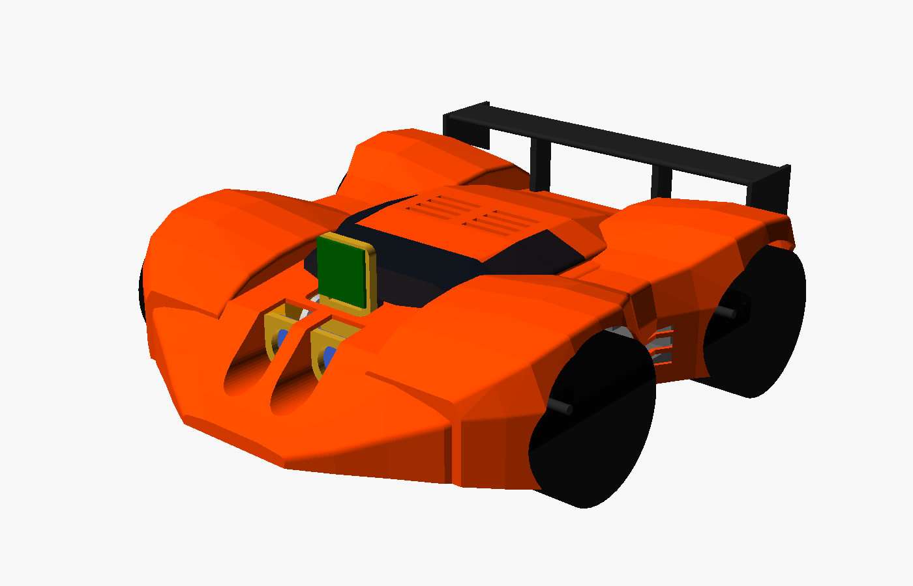

# Шасси aiai-car (4WD, печать углеволокном)

Параметрическая модель в OpenSCAD: `aiai_chassis.scad`. Все размеры — в начале файла, с русскими комментариями.
Готовые файлы для печати лежат в папке `stl/`. Картинка: `preview.png` (серое — плита, оранжевое — скобы, жёлтое — мачта и датчик, остальное — «призраки» плат, моторов и колёс).



## Что в комплекте

| Файл в `stl/` | Что это | Сколько печатать |
|---|---|---|
| `plate.stl` | основная плита 210 × 170 × 3,5 мм с рёбрами, седлами 4 моторов, стойками Raspberry Pi 4 и Arduino Uno, упорами батарейного отсека, гнёздами мачты и датчика | 1 |
| `clamp.stl` | скоба мотора 25GA (прижимает мотор к седлу) | **8** |
| `mast.stl` | мачта камеры Raspberry Pi Camera Module 3 (отверстия 21 × 12,5 мм) | 1 |
| `sensor.stl` | держатель датчика расстояния HC-SR04, ставится спереди | 1 |
| `sensor_servo.stl` | *по желанию*: голова датчика для сервопривода SG90 (вместо `sensor.stl`) | 0 или 1 |

Плита влезает на стол 220 × 220 мм (запас по 5 мм). Если стол меньше или края не печатаются, уменьши `plate_L` и `plate_W` в начале файла.

## Размеры

- Плита: 210 × 170 мм, толщина 3,5 мм, бортик и рёбра высотой 5–6 мм, высота с мачтой около 69 мм.
- Колёсная база: 120 мм (оси на X = ±60 мм). Ось колёс стоит на высоте 18,5 мм над столом, при колёсах диаметром 65 мм клиренс под плитой около 14 мм.
- С колёсами (65 × 27 мм) машинка получается шириной около 225 мм.
- Raspberry Pi стоит на стойках высотой 26 мм над батарейным отсеком (отсек 19 мм).
- Arduino Uno стоит сзади на стойках 6 мм, USB-разъём смотрит назад, в бортике для него есть окно.

## Настройки печати

- **Материал:** PETG-CF (прочнее и не такой хрупкий) или PLA-CF (жёстче, но хрупче).
- **Сопло:** только закалённое (сталь или рубин), диаметр 0,4 мм или 0,6 мм. Латунное быстро стачивается.
- **Высота слоя:** 0,2 мм.
- **Стенки (периметры):** 3–4.
- **Заполнение:** 30–40% (гироид или кубическое). Для `clamp.stl` и `sensor_servo.stl` лучше 60–100%.
- **Верх и низ:** 4–5 слоёв.
- **Поддержки:** не нужны. Все детали печатаются плоской стороной на стол: плита — рёбрами вверх, скобы — плоской гранью вниз, мачта и датчик — лёжа.
- **Стол:** подогрев по инструкции к филаменту (PETG-CF около 80 °C, PLA-CF около 60 °C), клей-карандаш и юбка.
- Углеволокно сушится: перед печатью подержи катушку в сушилке 4–6 часов.

## Какие винты нужны

| Куда | Винты | Сколько |
|---|---|---|
| Скобы моторов к седлам | M3 × 16 (с цилиндрической головкой) | 16 |
| Мачта в гнездо плиты | M3 × 14 (саморез в пластик или с гайкой) | 2 |
| Датчик HC-SR04 в гнездо плиты | M3 × 12 | 2 |
| Raspberry Pi 4 на стойки | M2,5 × 8 | 4 |
| Arduino Uno на стойки | M3 × 8 | 4 |
| Камера Pi Camera Module 3 на мачту | M2 × 6 и гайки (или M2 саморезы) | 4 |
| Сервопривод SG90 (по желанию) | M2 × 8 (саморезы из комплекта) | 2 |

Ещё нужно: 4–6 пластиковых хомутов 2,5 × 100 мм для батарейного отсека 2×18650, термоусадка и скотч для проводов. Резьба в стойках и седлах нарезается самим винтом, так что вкручивай аккуратно и без усилия. Для прочности можно поставить латунные вставки M2,5 и M3.

## Как собрать

1. Напечатай детали. Скобы печатаются 8 штук.
2. Вставь моторы в седла: торец редуктора упирается в стенку, вал выходит в вырез. Сверху прижми скобой и закрути 2 винта M3.
3. Установи батарейный отсек между упорами и затяни хомутами через прорези в плите.
4. Поставь Arduino и Raspberry Pi на стойки. Платы не должны касаться друг друга и проводов.
5. Вставь мачту и датчик в гнёзда плиты, закрепи винтами.
6. Провода моторов пропусти в круглые отверстия возле моторов, шлейф камеры и провода датчика — в щель перед мачтой.

## Как изменить

Открой `aiai_chassis.scad` в OpenSCAD и поменяй числа вверху файла. Для экспорта нужной детали:

```
openscad -D 'part="plate"' -o stl/plate.stl aiai_chassis.scad
```

Параметр `use_servo = true` включает режим с сервоприводом SG90. Скрипт `build.sh` пересобирает все STL и картинку.

## Что важно проверить перед печатью

- Длина моторов 25GA бывает разной. Измерь свой мотор и поставь `motor_len` (от торца редуктора до задней крышки без вала) и `motor_d`. Если мотор длиннее 50 мм, он упрётся в пространство для плат.
- Размеры батарейного отсека тоже разные. Проверь `bat_l`, `bat_w`, `bat_h`.
- Сначала распечатай одну скобу и седло (можно уменьшить плиту) и примерь мотор. Если мотор болтается или не влезает, подправь `motor_tol`.
- Алюминий не нужен: углеволокно и так жёсткое, но оно может проводить ток, поэтому не прижимай голые контакты плат к стойкам.
- Драйвер моторов (TB6612FNG) и понижающий модуль питания в плите отдельных стоек не имеют: их можно приклеить на двусторонний скотч или привязать хомутами.
- В режиме с сервоприводом голова датчика поворачивается не больше чем на ±45°, иначе заденет мачту. Хочешь больше — подвинь `mast_x` назад.

---

# Кузов «суперкар» (`aiai_body.scad`)

Низкий клиновидный кузов в стиле Lamborghini / McLaren: длинный острый нос, который спускается почти до плиты, широкие крылья, полностью закрывающие колёса сверху и с боков, низкая кабина со стеклом сдвинута назад, острые боковые воздухозаборники, «диффузор» сзади и большое заднее крыло на высоких стойках. Стенка 2 мм.



Вид сбоку: `body_side.png`. Вид сзади: `body_preview_back.png`. Кузов насквозь (видно, как всё помещается внутри): `body_preview_fit.png`.
(Тёмное «стекло» и чёрное крыло на картинках — просто цвет для превью, печатается всё одним пластиком, красится как хочешь.)

## Файлы

Кузов шире стола (≈ 224 × 248 мм), поэтому он разрезан на 4 четверти + крыло:

| Файл | Что это | Размер, мм |
|---|---|---|
| `stl/body_fl.stl` | перед-лево (с носом и глазками) | 124 × 116 × 55,5 |
| `stl/body_fr.stl` | перед-право | 124 × 111 × 55,5 |
| `stl/body_rl.stl` | зад-лево (с отверстиями под USB, питание, выключатель) | 129 × 117 × 59,5 |
| `stl/body_rr.stl` | зад-право | 129 × 112 × 59,5 |
| `stl/wing.stl` | заднее крыло (лежит крылом на столе) | 35 × 176 × 40 |

Всего на собранной машине: примерно 248 (длина) × 224 (ширина) × 63 (высота) мм, крыло шириной 176 мм. Каждая деталь влезает в стол 220 × 220.

## Как собирается

- Склей четыре четверти между собой: у каждой есть «язычок» 5 мм, он заходит в соседнюю, и детали сами центрируются (вдоль и поперёк). Клей: цианоакрилат или эпоксидка. Сначала склей перед-лево + перед-право и зад-лево + зад-право, потом половинки друг с другом.
- Нижний край кузова стоит на плите (по краю), бортик плиты спрятан внутри. Зазор 0,4 мм.
- 4 винта M3 × 16–20 снизу через угловые отверстия плиты (±97, ±77) вкручиваются в столбики внутри кузова (отверстие 2,6 мм, резьба нарезается самим винтом).
- Крыло: две стойки со шипами вставляются в пазы на «багажнике» и приклеиваются.

## Отверстия в кузове

- Нос сплошной (внутри редкое заполнение), в нём два открытых сверху канала под «глазки» HC-SR04 — луч идёт вперёд свободно.
- Окно в капоте: мачта и камера торчат наружу.
- Щели над Raspberry Pi и боковые воздухозаборники — охлаждение.
- Сзади: USB Arduino, гнездо питания Arduino, порт зарядки аккумуляторов (16 × 10) и круглое отверстие 12 мм под выключатель; щели диффузора по бокам.
- Арки вокруг колёс: колёса целиком закрыты крыльями сверху и сбоку, снизу арки открыты.

Чтобы добраться до USB и Ethernet на Raspberry Pi или вытащить SD-карту, сними кузов (4 винта).

## Советы по печати

- Печатай четверти «как стоят» (крышей вверх, открытой стороной вниз). Нужны поддержки: лучше «деревья» (tree supports), плотность 10–15 %. Под арками поддержки будет много — это нормально.
- Слой 0,2 мм, 3 периметра, заполнение 10–15 %. PETG или ABS/ASA лучше, чем PLA (в машине тепло).
- Крыло печатается без поддержек: оно лежит на столе, стойки торчат вверх.
- Шлифуй наждачкой 120 → 240 → 400. Потом грунт-наполнитель (он заделывает полосы слоёв), снова шлифовка и краска из баллончика, сверху лак. Стёкла можно закрасить чёрным.
- Сначала распечатай `body_fl` (нос с каналами) и примерь на шасси — так экономнее.

## Что проверить

- Это форма, нарисованная кодом из гладких переходов между сечениями. Она угловатая, как у суперкаров, но не как в 3D-редакторе. Если что-то не нравится, подвигай числа в списках `base`, `cabin`, `fender` в начале файла.
- Положение гнезда питания и USB Arduino я посчитал по плате Uno: проверь по своей и подвинь отверстия в `cuts()`.
- Файл `aiai_body.scad` берёт размеры шасси из своих первых строк (они продублированы). Поменял шасси — поменяй и тут.
- Чтобы пересобрать всё: `sh build.sh`.
